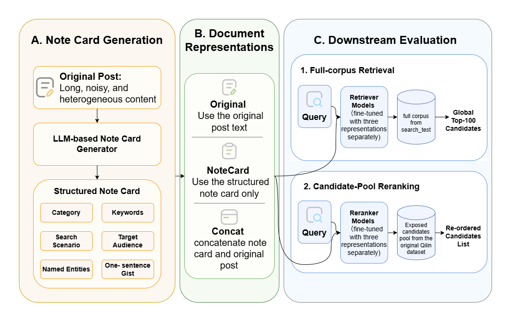

# When Do LLM-Generated Note Cards Help Retrieval and Reranking?

<p align="center">
  <a href="paper.pdf"></a>
  <a href="https://openreview.net/forum?id=us86HOM1oD"></a>
  <a href="https://xdeadlocked.github.io/SynthIR_Web/SIGIR2026Workshop-SynthIR"></a>
  <a href="LICENSE"></a>
  <a href="https://github.com/Shanmin123/llm-notecards/releases"></a>
</p>

Code and data for the SynthIR @ SIGIR 2026 workshop paper

> **When Do LLM-Generated Note Cards Help Retrieval and Reranking?**<br>
> Shanmin Sun, Xinlu Lin (University of Edinburgh)<br>
> *The 1st Workshop on Synthetic Content in Information Retrieval Ecosystems (SynthIR) at SIGIR 2026*,
> Melbourne, Australia, July 24, 2026<br>
>
> [[Paper (PDF)]](paper.pdf) [[OpenReview]](https://openreview.net/forum?id=us86HOM1oD)
> [[Workshop]](https://xdeadlocked.github.io/SynthIR_Web/SIGIR2026Workshop-SynthIR) [[Citation]](#citation)

<p align="center">
  
</p>
<p align="center"><em>
Figure 1: An LLM generates a structured note card from each post offline; the three document
representations are then evaluated in global first-stage retrieval over an expanded corpus and
in reranking of a query-specific candidate pool.
</em></p>

## Overview

We study whether **LLM-generated structured note cards**, six-field summaries that compress a noisy
Xiaohongshu (RedNote) post into retrieval-oriented content, improve search when they are added as an
offline document representation. The repository contains the full pipeline used in the paper:

- **A. Note-card generation.** A training-free pipeline: regex denoising, a fixed few-shot prompt and
  greedy decoding turn each post into six fields (category, keywords, search scenario, target audience,
  named entities, one-sentence gist), followed by a format and field-validity audit of the cards.
- **B. Document representations.** **Original** (title + body), **NoteCard** (the card alone) and
  **StructuredConcat** (card + original text), all built from the same Qwen3-4B-Instruct-2507 cards.
- **C. Downstream evaluation** on the [Qilin](https://github.com/RED-Search/Qilin) search benchmark:
  1. *expanded-pool retrieval*: global top-100 retrieval from a 113,548-note corpus with a BERT
     bi-encoder (zero-shot and fine-tuned) and Qwen3-Embedding-0.6B (zero-shot and LoRA);
  2. *candidate-pool reranking*: reranking each query's exposed candidates with Qwen3-Reranker-0.6B
     and MacBERT / RoBERTa cross-encoders, over the full train × inference representation grid.

**Main findings.** The effect of the card is model- and stage-dependent. It helps the weak BERT
bi-encoder through the *inference-time* view (fine-tuned MRR@10 0.2748 → 0.3085 with StructuredConcat),
gives little to Qwen3-Embedding-0.6B, and helps Qwen3-Reranker mainly through *card-augmented training*
(MRR@10 0.5260 → 0.6970). Across settings the card is more reliable as an augmentation than as a replacement.

## Repository structure

```
llm-notecards/
├── paper.pdf                              # the paper (camera-ready)
├── assets/pipeline.png                    # Figure 1
├── data/                                  # Qilin data + released note cards (see data/README.md)
├── notecard_generation/                   # A. note-card generation
│   ├── generate_notecards.py              #    LLM generation (resumable, regenerates malformed cards)
│   └── evaluate_card_quality.py           #    format / field-validity audit (Section 4)
├── src/                                   # B + C. representations, retrieval, cross-encoder reranking
│   ├── common.py                          #    data loading, representations, metrics (shared)
│   ├── retrieval_zero_shot.py             #    zero-shot expanded-pool retrieval
│   ├── retrieval_train.py                 #    hard-negative mining + fine-tuning (BERT, Qwen3-Embedding)
│   ├── retrieval_eval.py                  #    test evaluation of saved retrievers
│   ├── rerank_cross_encoder.py            #    MacBERT / RoBERTa cross-encoder training
│   └── rerank_cross_encoder_eval.py       #    train x inference reranking grid
├── qwen3_reranker/                        # C. Qwen3-Reranker-0.6B fine-tuning and evaluation
│   ├── train.py
│   └── eval.py
├── scripts/                               # one script per experiment (steps 01-07)
└── tests/                                 # unit tests (python -m unittest discover -s tests)
```

## Installation

```bash
git clone https://github.com/Shanmin123/llm-notecards.git
cd llm-notecards
conda create -n notecards python=3.10 -y
conda activate notecards
pip install torch                 # pick the CUDA build that matches your driver
pip install -r requirements.txt
```

Tested with Python 3.10, PyTorch 2.6, Transformers 5.3 and PEFT 0.19 (Transformers ≥ 4.51 is needed for Qwen3).

## Data

All scripts read from `data/` by default; [data/README.md](data/README.md) describes every file.

```bash
# 1. Qilin (Apache-2.0): notes and search splits from Hugging Face
python -c "from huggingface_hub import snapshot_download; snapshot_download('THUIR/Qilin', repo_type='dataset', local_dir='data', allow_patterns=['notes/*', 'search_train/*', 'search_test/*'])"

# 2. Official search relevance labels
mkdir -p data/qrels
curl -L -o data/qrels/search.test.qrels.csv https://raw.githubusercontent.com/RED-Search/Qilin/main/datasets/search.test.qrels.csv

# 3. Our note cards (Qwen3-4B-Instruct-2507)
curl -L -o notecards.zip https://github.com/Shanmin123/llm-notecards/releases/download/v1.0/notecards.zip
unzip notecards.zip -d data/
```

## Reproducing the paper

Run the scripts from the repository root. Each step writes to `outputs/`.

| Step | Script | Paper | What it does |
|---|---|---|---|
| 1 | [`scripts/01_generate_notecards.sh`](scripts/01_generate_notecards.sh) | §3 | Generate note cards (optional; the released cards come from this exact setup) |
| 2 | [`scripts/02_evaluate_card_quality.sh`](scripts/02_evaluate_card_quality.sh) | §4 | Format-broken rate, fully-complete rate, per-field validity |
| 3 | [`scripts/03_retrieval_bert_zero_shot.sh`](scripts/03_retrieval_bert_zero_shot.sh) | Table 2 | Zero-shot BERT bi-encoder, expanded-pool retrieval |
| 4 | [`scripts/04_retrieval_bert_finetune.sh`](scripts/04_retrieval_bert_finetune.sh) | Table 2 | Fine-tuned BERT bi-encoder (hard negatives, lr selected on validation) |
| 5 | [`scripts/05_retrieval_qwen3_embedding.sh`](scripts/05_retrieval_qwen3_embedding.sh) | Table 2 | Qwen3-Embedding-0.6B, zero-shot and LoRA |
| 6 | [`scripts/06_rerank_cross_encoders.sh`](scripts/06_rerank_cross_encoders.sh) | Table 3 | MacBERT / RoBERTa cross-encoders, train × inference grid |
| 7 | [`scripts/07_rerank_qwen3_reranker.sh`](scripts/07_rerank_qwen3_reranker.sh) | Table 3 | Qwen3-Reranker-0.6B, train × inference grid |

**Protocol.** Training queries `search_train[0:4000]`, validation `search_train[4000:5000]`, test
`search_test[0:1000]`, scored with the official `search.test.qrels.csv`. Expanded-pool retrieval ranks the
union of the exposed candidates of `search_test[0:6192]` that have a card (113,548 notes, covering all
5,566 relevant notes); reranking reorders each query's own exposed candidates. Retriever learning rates are
selected on validation MRR@10 (BERT 5e-5, Qwen3-Embedding 2e-6) and Qwen3-Reranker keeps the epoch with the
lowest validation loss. MAP@k normalises average precision by min(k, R<sub>q</sub>).

**Representation names in the code.** The `--modes` / `--train_mode` / `--eval_mode` arguments use

| Paper | Code | Document text |
|---|---|---|
| Original | `original` | `title \n content` |
| NoteCard | `summary` | the six-field card |
| StructuredConcat | `combined` | `[Notecard] \n card \n [Original Note] \n Title: … \n Content: …` |

`title_summary` (title + card) and the `*_content_head` modes are extra ablations that are not reported in the paper.

**Hardware.** Steps 2, 3 and 6 and the evaluations fit on a 12 GB GPU. The retriever fine-tuning runs of
steps 4-5 were done on a single 71 GB GPU slice, and full-parameter Qwen3-Reranker training (step 7) needs
at least 16 GB. Generating cards with Qwen3-4B takes about 10 s per card at batch size 1 on a 12 GB laptop GPU.

## Results

**Note-card quality** (Qwen3-4B-Instruct-2507, first-pass cards of the test exposure pool, 22,598 cards;
`scripts/02_evaluate_card_quality.sh`). For comparison, Qwen2.5-3B-Instruct fails to produce a parseable
card on 4.04% of inputs and has 43.10% valid entity fields (paper, Section 4).

| Format-broken ↓ | Fully complete | Category | Keywords | Scenario | Audience | Entities | Gist |
|---:|---:|---:|---:|---:|---:|---:|---:|
| 0.01% | 46.51% | 99.28% | 100.00% | 99.38% | 99.38% | 46.54% | 99.38% |

Most invalid entity fields are posts without any explicit brand, product, person or place, for which the
card correctly says `实体: 无` ("none").

**Table 2 - Expanded-pool retrieval** over the 113,548-note test corpus (train → inference representation;
O = Original, N = NoteCard, S = StructuredConcat).

| Retriever | Representation | MRR@10 | MAP@10 | R@10 |
|---|---|---:|---:|---:|
| BERT bi-encoder, zero-shot | O | 0.0630 | 0.0213 | 0.0515 |
| | N | **0.2063** | **0.0907** | **0.1861** |
| | S | 0.1761 | 0.0731 | 0.1519 |
| BERT bi-encoder, fine-tuned | O → O | 0.2748 | 0.1310 | 0.2637 |
| | O → N | 0.2878 | 0.1466 | 0.2950 |
| | O → S | **0.3085** | **0.1552** | **0.3022** |
| | S → O | 0.2000 | 0.0836 | 0.1748 |
| | S → N | 0.2725 | 0.1342 | 0.2713 |
| | S → S | 0.2937 | 0.1490 | 0.2952 |
| Qwen3-Embedding-0.6B, zero-shot | O | 0.4187 | 0.2492 | 0.4719 |
| | N | 0.4004 | 0.2332 | 0.4508 |
| | S | 0.4188 | 0.2494 | 0.4722 |
| Qwen3-Embedding-0.6B, LoRA | O → O | 0.4194 | **0.2519** | 0.4722 |
| | O → N | 0.3959 | 0.2337 | 0.4506 |
| | O → S | 0.4151 | 0.2464 | 0.4721 |
| | S → O | **0.4205** | 0.2501 | 0.4729 |
| | S → N | 0.3963 | 0.2330 | 0.4506 |
| | S → S | 0.4145 | 0.2484 | **0.4736** |

**Table 3 - Candidate-pool reranking**, MRR@10 for each training representation (rows) evaluated with each
inference representation (columns).

| Reranker | Train | → O | → N | → S |
|---|---|---:|---:|---:|
| Qwen3-Reranker-0.6B | O | 0.5260 | 0.5770 | 0.5219 |
| | N | 0.5951 | 0.6207 | 0.5896 |
| | S | 0.6784 | 0.5903 | **0.6970** |
| MacBERT cross-encoder | O | **0.5169** | 0.5072 | 0.5030 |
| | N | 0.5041 | 0.5072 | 0.5106 |
| | S | 0.4859 | 0.5077 | 0.5071 |
| RoBERTa cross-encoder | O | 0.4911 | **0.5086** | 0.4949 |
| | N | 0.4858 | 0.5032 | 0.4914 |
| | S | 0.4890 | 0.5052 | 0.4969 |

Numbers are single-seed point estimates.

## Note-card example

The representative post of Table 1 in the paper (Qilin note 1245196):

```text
Title: 婺源旅游地图（2024最新版·独家绘制）
Body:  2024版婺源全域旅游地图新鲜出炉（含大批小众景点） 照片为今日（20240408）拍摄的婺源实景照，……
       #婺源小众景点[话题]# #婺源旅游[话题]# #最新婺源旅游地图[话题]# #旅游攻略[话题]#
```

Its card, as stored in `data/test_notecard.json`:

```text
类目: 旅游
关键词: 婺源旅游, 旅游地图, 小众景点, 2024最新版, 全域旅游
场景: 想了解婺源最新旅游地图
人群: 旅行爱好者, 婺源游客
实体: 婺源
摘要: 2024最新版婺源全域旅游地图含小众景点，提供实景参考
```

| Field | English translation (paper, Table 1) |
|---|---|
| Category | Travel |
| Keywords | Wuyuan tourism, tourism map, hidden attractions, latest 2024 edition, full-region tourism |
| Scene | Looking for the latest Wuyuan tourism map |
| Audience | Travel enthusiasts, Wuyuan visitors |
| Entities | Wuyuan |
| Gist | 2024 latest Wuyuan tourism map including hidden attractions, with real-scene reference photos |

## Citation

If you use this code or the note cards, please cite our paper and the Qilin dataset:

```bibtex
@inproceedings{
sun2026when,
title={When Do {LLM}-Generated Note Cards Help Retrieval and Reranking?},
author={Shanmin Sun and Xinlu Lin},
booktitle={The 1st Workshop on Synthetic Content in Information Retrieval Ecosystems},
year={2026},
url={https://openreview.net/forum?id=us86HOM1oD}
}

@inproceedings{chen2025qilin,
  title     = {Qilin: A Multimodal Information Retrieval Dataset with {APP}-level User Sessions},
  author    = {Chen, Jia and Dong, Qian and Li, Haitao and He, Xiaohui and Gao, Yan and Cao, Shaosheng and Wu, Yi and Yang, Ping and Xu, Chen and Hu, Yao and Ai, Qingyao and Liu, Yiqun},
  booktitle = {Proceedings of the 48th International ACM SIGIR Conference on Research and Development in Information Retrieval},
  pages     = {1441--1450},
  year      = {2025},
  doi       = {10.1145/3726302.3730279}
}
```

## Acknowledgements

We thank the authors of [Qilin](https://github.com/RED-Search/Qilin) for the dataset and baseline code that
our cross-encoder and bi-encoder setups follow, and the Qwen team for the open models. The note-card prompt
and the Qwen3-Reranker training and evaluation code were written by Xinlu Lin and first released in
[AzumaLin/qilin-note-rerank](https://github.com/AzumaLin/qilin-note-rerank).

## License

The code is released under the [MIT License](LICENSE). The note cards are LLM-generated summaries of
notes from the Qilin dataset (Apache-2.0); please cite Qilin as well when you use them.
